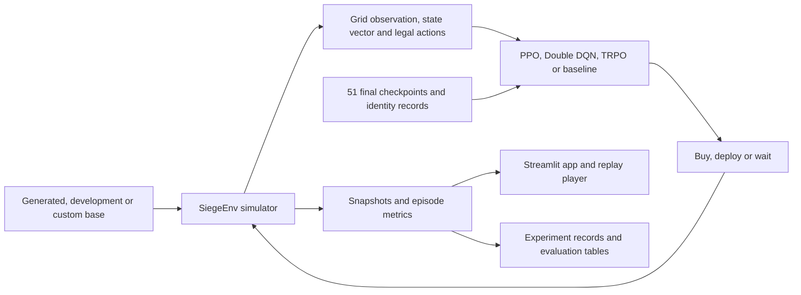

# Base Siege

**Learning how to choose an army and deploy it against an unfamiliar base.**

A good attack requires more than buying the strongest troops. The army has to fit a
limited budget, reach useful targets and survive long enough to destroy the base.
Base Siege turns these connected decisions into a reinforcement learning problem
in a custom 16 × 16 simulator.

We built the environment, trained and evaluated **Maskable PPO, masked Double DQN
and Maskable TRPO**, and created an interactive app for inspecting their behaviour.
The project also studies whether rotating and reflecting observations helps PPO
generalise to new layouts. Action masks enforce legal purchases and deployments;
the policy still has to learn which legal choices are useful.

Developed by **Chandan, Sreekar and Vaibhav** for **43008 Reinforcement Learning,
University of Technology Sydney**.

[Open the live demo](https://base-siege-dihedrals.streamlit.app/)

## What you can do

- Play an attack manually, from buying troops to placing them around the perimeter.
- Compare learned policies with heuristic and valid-random baselines.
- Select any of the **51 final checkpoints**: 40 PPO, ten TRPO and one selected DDQN.
- Explore generated layouts, the development pool or a custom base built in the editor.
- Watch decision replays and download them as JSON or a standalone HTML player.
- Inspect the recorded experiments, training histories and frozen evaluation results.

## How it works



Each episode has a 200-resource budget, four troop types and a 300-tick battle
limit. Shopping and deployment share one decision process. The reward combines
non-wall destruction, milestone bonuses and a spending penalty. Destruction and
full-clear rate are reported separately from reward.

The simulator is the authority for combat. The browser renders replay snapshots;
manual browser controls are checked against the Python environment. See the
[architecture guide](docs/ARCHITECTURE.md) for observations, actions, symmetry,
recovery and evaluation contracts.

## Run the app

Use **Python 3.12** and Git LFS. Run commands from the repository root.

```bash
git lfs install
GIT_LFS_SKIP_SMUDGE=1 git clone https://github.com/Reinforcement-Learning-UTS/base-siege-dihedrals.git
cd base-siege-dihedrals
git lfs pull --include="$(cat models/lfs-paths.txt)"
python3.12 -m venv .venv
source .venv/bin/activate
python -m pip install -r ui/requirements.txt
python -m streamlit run ui/streamlit_app.py
```

The app uses a curated final-model catalog and CPU inference. All final seeds are
available on disk; bounded caches load only the models visitors select. The final
weights total **212.25 MB**, before dependencies and sidecars. The LFS include list
also covers identical aliases used by the research tools. It avoids downloading
the entire checkpoint archive during an ordinary checkout.

`ui/app.py` provides the local research profile. `ui/streamlit_app.py` provides the
same interactive application with curated models and saved replays for hosting.
Neither entrypoint starts training. Final evaluation seeds are blocked in
interactive play to protect the experimental separation.

## Experiments and findings

P is PPO without D4 augmentation; PA is PPO with rotations and reflections. T is
Maskable TRPO. The frozen V3 evaluation records the following means over ten
independent learners per learned condition:

| Condition | Mean destruction | Full-clear rate |
|---|---:|---:|
| PPO P | 92.95% | 74.25% |
| PPO PA | 93.63% | 77.07% |
| TRPO T | 56.11% | 7.54% |
| Heuristic | 55.09% | 3.53% |

Source: `artifacts/version3-final-evaluation/condition_summary.csv`. These are the
frozen **DS** results. A separate exploratory acting-mode probe improved TRPO under
**SS**; the app labels those modes and does not substitute that probe for the
frozen result.

The selected DDQN seed-100 checkpoint achieved **54.41% destruction** and **21.70%
full clears** on the V2 benchmark. It uses a different budget, learner count and
acting procedure. These studies do **not** establish a controlled ranking of all
three algorithms. The [results guide](docs/RESULTS.md) identifies the canonical
records, report-figure inputs and limitations.

This is a simplified simulator with partial observations and deterministic combat
rules. Findings apply to this environment and its frozen layout pools. Training
recovery is supplied for PPO and TRPO; complete DDQN training recovery is absent.

## Repository guide

| Path | Contents |
|---|---|
| `env/`, `agents/` | Combat simulator, masks, symmetry and baseline commanders |
| `train/`, `experiments/` | PPO training, shared experiments and recovery |
| `trpo/`, `ddqn_experiment/` | Masked TRPO and Double DQN implementations |
| `version2/`, `v2_*/`, `v3_*/`, `ddqn_final_benchmark/` | Versioned study and evaluation workflows |
| `ui/`, `prototype/` | Streamlit app, editor, playback and browser prototype |
| `models/`, `provenance/` | Final-model catalog and exact source compatibility records |
| `bases/` | Layout pools and registrations |
| `runs/`, `artifacts/`, `version2-records/` | Original weights, histories, protocols and results |
| `notebooks/`, `final_evaluation_bundle/` | Research notebooks and evaluation utilities |
| `tools/`, `deployment/`, `.github/workflows/` | Checks, app packaging and CI |
| `docs/` | Technical guides and original experiment handbooks |

Scientific inputs, outputs, models and recovery records retain their original
bytes. Scientific loaders check their original runtime and source identities;
application adapters have a separately tested CPU inference boundary.

## Tests and deployment

For the research suite, use the recorded **Python 3.12.14** runtime:

```bash
python -m pip install -r ui/requirements.txt -r deployment/requirements-project-test.txt
python -m pytest -q tests trpo ddqn_experiment ddqn_final_benchmark version2 \
  v2_cohort_evaluation v2_development v2_final v2_phases v2_replays \
  v2_replication v3_final v3_probe
mkdir -p local-output
python tools/check_demo_models.py --out local-output/models.json
python tools/build_deploy_bundle.py --out local-output/streamlit-app
```

GitHub Actions separates the exact research runtime from Linux CPU application
checks. It runs regression and short recovery tests, verifies all 51 checkpoints,
and checks the standalone deployment bundle. It does not repeat the full studies.

The app is prepared for **Streamlit Community Cloud**. The standalone bundle
contains every final model and its required source and sidecars. See
[deployment](docs/DEPLOYMENT.md) for installation, host settings and checks to run
on the real hosted app. A local bundle or CI pass is not evidence of deployment.

[Documentation index](docs/README.md) · [Models](docs/MODELS.md) ·
[Results](docs/RESULTS.md) · [Research runbook](docs/RUNBOOK.md)
